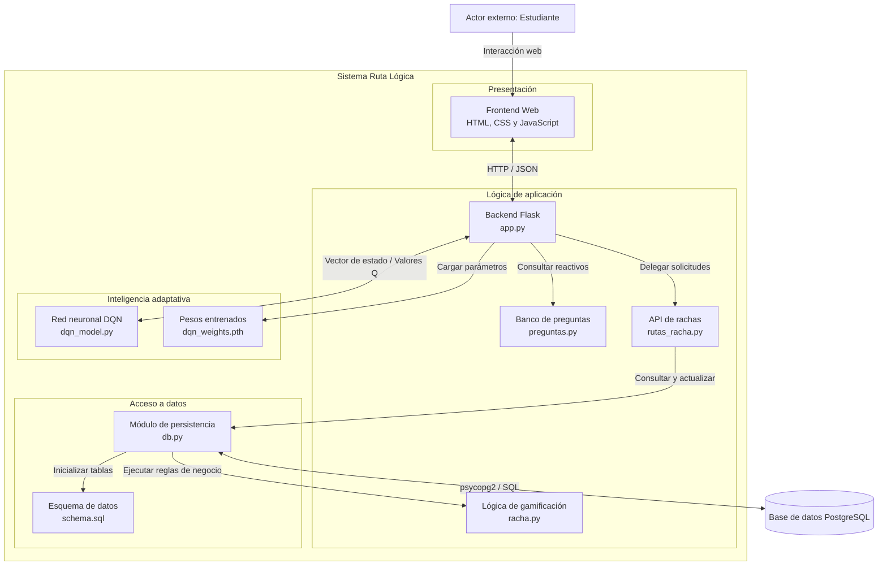
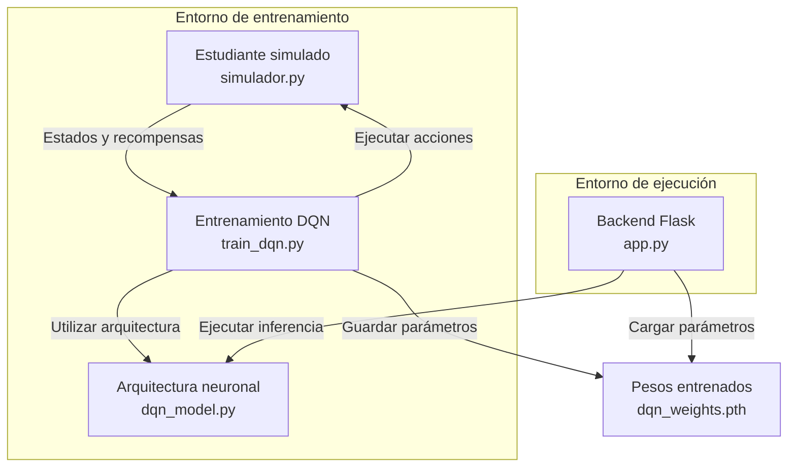

# Ruta Lógica - Demo Proyecto de Tesis

## 1. Descripción del proyecto

Ruta Lógica es un prototipo de sistema web de repetición espaciada basado en el algoritmo Deep Q-Networks (DQN) con PyTorch, orientado a la estimulación del interés cognitivo en el razonamiento lógico-matemático de estudiantes de 5.° de secundaria de la I.E. 80818 Jorge Basadre Grohmann, Trujillo - 2027.

El sistema analiza las respuestas, los tiempos de reacción, la cantidad de repasos previos y la dificultad de los reactivos para generar recomendaciones adaptativas de repaso y pausas activas.

## 2. Arquitectura del sistema

El prototipo se fundamenta en una arquitectura cliente-servidor que integra componentes de presentación, lógica de aplicación, inteligencia adaptativa, contenido académico, gamificación y persistencia de datos.

La separación de estos componentes permite organizar las responsabilidades del sistema y facilita su mantenimiento, integración y ampliación progresiva.

## 3. Componentes del sistema

A continuación, se describen los componentes que conforman el prototipo, sus responsabilidades, archivos asociados y relaciones con los demás elementos del sistema.

### 3.1. Usuario del sistema

**Componente:** Estudiante.

**Clasificación:** Actor externo.

El estudiante es el usuario principal del sistema, quien interactúa con la plataforma web mediante un navegador.

**Responsabilidades:**

- Acceder al sistema mediante un código de estudiante.
- Resolver la evaluación general inicial.
- Desarrollar los cuestionarios temáticos.
- Consultar las recomendaciones adaptativas de repaso.
- Participar en las misiones diarias.
- Interactuar con la mascota virtual.
- Realizar las pausas activas recomendadas.

**Interacción:** Se comunica directamente con el frontend mediante la interfaz gráfica del sistema.

### 3.2. Componente de presentación

**Componente:** Frontend Web.

**Clasificación:** Interno.

**Tecnologías:** HTML5, CSS3 y JavaScript.

**Archivos asociados:**

- `frontend/index.html`
- `frontend/styles.css`
- `frontend/app.js`

Este componente proporciona la interfaz gráfica mediante la cual el estudiante interactúa con las funcionalidades del prototipo.

**Responsabilidades:**

- Presentar la pantalla de acceso.
- Mostrar la evaluación general de 16 reactivos.
- Presentar los cuestionarios temáticos.
- Capturar las alternativas seleccionadas.
- Medir la latencia de respuesta en milisegundos.
- Mostrar las recomendaciones de repetición espaciada.
- Gestionar la visualización de las pausas activas.
- Presentar el dashboard de seguimiento.
- Visualizar las rachas y misiones diarias.
- Gestionar la interacción con la mascota virtual Profesor Basadrito.
- Mostrar el vector de estado y los valores Q en el panel del evaluador.

**Interacción:** Se comunica con el backend Flask mediante solicitudes HTTP y respuestas en formato JSON.

### 3.3. Componente de lógica de aplicación

**Componente:** Backend Flask.

**Clasificación:** Interno.

**Tecnologías:** Python y Flask.

**Archivos asociados:**

- `backend/app.py`
- `backend/rutas_racha.py`

Este componente centraliza la lógica de aplicación y coordina la comunicación entre la interfaz web, el banco de preguntas, el modelo de inteligencia artificial y el subsistema de persistencia.

**Responsabilidades:**

- Exponer los endpoints de la API REST.
- Recibir las solicitudes del frontend.
- Recuperar los reactivos de razonamiento lógico-matemático.
- Verificar las respuestas del estudiante.
- Normalizar las variables de entrada.
- Construir el vector de estado del algoritmo DQN.
- Ejecutar la inferencia del modelo.
- Aplicar la regla complementaria de latencia elevada.
- Gestionar las solicitudes relacionadas con las rachas y misiones.
- Devolver los resultados al frontend en formato JSON.

**Interacción:** Se comunica con el frontend, el banco de preguntas, el modelo DQN y el módulo de acceso a datos.

### 3.4. Componente de inteligencia adaptativa

**Componente:** Motor de inferencia Deep Q-Networks (DQN).

**Clasificación:** Interno.

**Tecnología:** PyTorch.

**Archivos asociados:**

- `backend/dqn_model.py`
- `backend/dqn_weights.pth`

Este componente implementa una red neuronal profunda basada en aprendizaje por refuerzo, encargada de estimar el valor de las acciones adaptativas disponibles a partir del estado observado del estudiante.

La red neuronal está compuesta por cuatro entradas, dos capas ocultas de 32 neuronas y cuatro salidas correspondientes a los valores Q de las acciones.

#### 3.4.1. Arquitectura de la red neuronal

| Capa | Número de neuronas | Función |
|---|---:|---|
| Entrada | 4 | Recepción del vector de estado. |
| Oculta 1 | 32 | Procesamiento de características mediante ReLU. |
| Oculta 2 | 32 | Procesamiento de representaciones internas mediante ReLU. |
| Salida | 4 | Estimación de los valores Q. |

#### 3.4.2. Vector de estado

El backend construye un vector de estado compuesto por cuatro variables:

| Variable | Descripción |
|---|---|
| Latencia normalizada | Tiempo empleado por el estudiante para responder. |
| Acierto | Indica si la respuesta seleccionada es correcta o incorrecta. |
| Repasos previos | Número de respuestas anteriores al mismo reactivo durante la ejecución del prototipo. |
| Dificultad | Nivel de dificultad del reactivo presentado. |

#### 3.4.3. Espacio de acciones

| Identificador | Acción adaptativa |
|---|---|
| A0 | Recomendar repaso en 2 horas. |
| A1 | Recomendar repaso en 1 día. |
| A2 | Recomendar repaso en 3 días. |
| A3 | Recomendar una pausa activa de 2 minutos. |

**Responsabilidades:**

- Definir la arquitectura de la red neuronal profunda.
- Procesar el vector de estado proporcionado por el backend.
- Calcular los valores Q correspondientes a las acciones disponibles.
- Proporcionar información para la selección de la acción adaptativa.
- Utilizar los parámetros obtenidos durante el entrenamiento.

**Interacción:** Recibe el vector de estado desde el backend Flask y devuelve los valores Q. El backend selecciona la acción correspondiente, considerando también la regla complementaria de latencia elevada.

### 3.5. Componente de contenido académico

**Componente:** Banco de preguntas.

**Clasificación:** Interno.

**Archivo asociado:**

- `backend/preguntas.py`

Este componente almacena los reactivos de razonamiento lógico-matemático utilizados durante la evaluación general y las sesiones de práctica temática.

**Temas implementados:**

- Sucesiones y Series Lógicas.
- Planteo de Ecuaciones y Proporciones.
- Problemas de Móviles y Cronometría.
- Porcentajes y Probabilidades.

Cada tema dispone de tres cuestionarios de cinco reactivos, conformando un banco de 60 preguntas.

La evaluación general inicial está compuesta por 16 reactivos reutilizados del banco de preguntas.

**Responsabilidades:**

- Almacenar los enunciados de los reactivos.
- Definir las alternativas de respuesta.
- Identificar la alternativa correcta.
- Establecer los niveles de dificultad.
- Organizar los cuestionarios por tema.
- Proporcionar los reactivos solicitados por el backend.

**Interacción:** El backend Flask consulta este componente para recuperar los cuestionarios y verificar las respuestas del estudiante.

### 3.6. Componente de gamificación

**Componente:** Módulo de rachas y misiones diarias.

**Clasificación:** Interno.

**Archivos asociados:**

- `backend/racha.py`
- `backend/rutas_racha.py`

Este componente incorpora mecanismos de gamificación orientados a incentivar la constancia y la participación del estudiante durante las sesiones de práctica.

El progreso diario está compuesto por cinco misiones, cada una equivalente al 20% de la meta diaria.

#### 3.6.1. Misiones diarias

| Misión | Condición | Progreso |
|---|---|---:|
| M1 | Completar un cuestionario temático de cinco reactivos. | 20% |
| M2 | Completar un cuestionario sin activación de pausas por fatiga. | 20% |
| M3 | Obtener al menos un 60% de respuestas correctas. | 20% |
| M4 | Obtener una latencia promedio inferior a seis segundos. | 20% |
| M5 | Completar un segundo cuestionario temático. | 20% |
| **Total** | **Completar las cinco misiones.** | **100%** |

**Responsabilidades:**

- Evaluar el cumplimiento de las misiones diarias.
- Calcular el porcentaje de progreso.
- Gestionar el estado de la racha del estudiante.
- Identificar el cumplimiento de la meta diaria.
- Permitir reclamar el siguiente día de racha.
- Proporcionar al frontend el estado de las misiones para habilitar la personalización de la mascota virtual.

**Interacción:** El módulo de acceso a datos ejecuta las reglas de negocio definidas en `racha.py`, mientras que `rutas_racha.py` permite acceder a estas funcionalidades mediante la API REST.

### 3.7. Componente de acceso a datos

**Componente:** Módulo de persistencia.

**Clasificación:** Interno.

**Tecnologías:** Python, psycopg2 y SQL.

**Archivos asociados:**

- `backend/db.py`
- `backend/schema.sql`

Este componente establece la comunicación entre la lógica de aplicación y el sistema gestor de base de datos PostgreSQL.

**Responsabilidades:**

- Establecer conexiones con PostgreSQL.
- Inicializar las tablas de la base de datos.
- Registrar identificadores de estudiantes.
- Consultar el estado de las rachas.
- Ejecutar las reglas de gamificación sobre el estado recuperado.
- Actualizar el progreso de las misiones diarias.
- Gestionar las transacciones de lectura y escritura.
- Controlar la concurrencia mediante bloqueos de registros.

**Interacción:** Recibe solicitudes desde la API de rachas, utiliza las reglas de negocio del módulo `racha.py` y ejecuta operaciones SQL sobre PostgreSQL.

### 3.8. Componente de almacenamiento

**Componente:** Base de datos PostgreSQL.

**Clasificación:** Externo al backend de aplicación.

**Tecnología:** PostgreSQL.

Este componente proporciona el almacenamiento persistente de los identificadores de estudiantes y del estado asociado al sistema de rachas.

**Tablas implementadas:**

| Tabla | Descripción |
|---|---|
| `estudiantes` | Almacena los identificadores y fechas de registro de los estudiantes. |
| `racha_estado` | Almacena la cantidad de días de racha, el cumplimiento de las misiones y la meta diaria. |

**Responsabilidades:**

- Persistir los identificadores de estudiantes.
- Almacenar el estado de las rachas.
- Registrar el cumplimiento de las misiones diarias.
- Mantener el progreso entre sesiones.
- Garantizar la integridad referencial entre las tablas.

**Interacción:** Se comunica con el módulo de acceso a datos mediante el controlador psycopg2 y sentencias SQL.

## 4. Componentes de soporte para el entrenamiento DQN

Estos componentes intervienen durante la etapa de entrenamiento del modelo de inteligencia artificial. No participan directamente en las sesiones de práctica del estudiante.

### 4.1. Entorno de simulación

**Componente:** Estudiante simulado.

**Clasificación:** Interno de soporte.

**Archivo asociado:**

- `backend/simulador.py`

Este componente representa de manera computacional el comportamiento de un estudiante mediante variables simuladas de retención, dificultad, precisión, latencia y fatiga.

**Responsabilidades:**

- Generar estados simulados del estudiante.
- Representar el decaimiento temporal de la memoria.
- Simular respuestas correctas e incorrectas.
- Simular variaciones en la latencia.
- Representar cambios en los niveles de fatiga.
- Calcular recompensas asociadas a las acciones del agente.
- Generar transiciones entre estados.

**Interacción:** Se comunica con el módulo de entrenamiento DQN, recibiendo acciones y devolviendo nuevos estados y recompensas.

### 4.2. Módulo de entrenamiento

**Componente:** Entrenamiento del agente Deep Q-Networks.

**Clasificación:** Interno de soporte.

**Tecnología:** PyTorch.

**Archivo asociado:**

- `backend/train_dqn.py`

Este componente realiza el entrenamiento de la red neuronal profunda mediante interacciones sucesivas con el entorno de simulación.

**Responsabilidades:**

- Inicializar la red neuronal principal y la red objetivo.
- Ejecutar la estrategia de exploración epsilon-greedy.
- Almacenar experiencias en una memoria de repetición.
- Seleccionar lotes de experiencias para el entrenamiento.
- Calcular la función de pérdida Smooth L1.
- Actualizar los parámetros de la red neuronal.
- Evaluar la política aprendida frente a una política aleatoria.
- Exportar los parámetros entrenados al archivo `dqn_weights.pth`.

**Interacción:** Utiliza el entorno de simulación y la arquitectura definida en `dqn_model.py` para entrenar el modelo.

### 4.3. Artefacto del modelo entrenado

**Componente:** Pesos entrenados del modelo DQN.

**Clasificación:** Artefacto interno.

**Archivo asociado:**

- `backend/dqn_weights.pth`

Este archivo contiene los parámetros de la red neuronal obtenidos durante el proceso de entrenamiento.

**Responsabilidades:**

- Conservar los parámetros aprendidos por el modelo.
- Permitir la carga de la red neuronal entrenada.
- Facilitar la ejecución de inferencias sin repetir el entrenamiento en cada inicio del sistema.

**Interacción:** Es generado por `train_dqn.py` y posteriormente cargado por `app.py` durante la inicialización del backend.

## 5. Diagrama de componentes del sistema

El siguiente diagrama representa los principales componentes que intervienen durante la ejecución del prototipo, así como sus relaciones y mecanismos de comunicación.

## 6. Diagrama de componentes del entrenamiento DQN

El siguiente diagrama representa la interacción entre los componentes responsables del entrenamiento y la posterior utilización del modelo en el prototipo.

## 7. Comunicación entre componentes

| Componente origen | Componente destino | Mecanismo de comunicación |
|---|---|---|
| Estudiante | Frontend Web | Interfaz gráfica del navegador. |
| Frontend Web | Backend Flask | API REST mediante HTTP y JSON. |
| Backend Flask | Banco de preguntas | Importación de módulos Python. |
| Backend Flask | Modelo DQN | Tensores y funciones de PyTorch. |
| Backend Flask | API de rachas | Flask Blueprint. |
| API de rachas | Módulo de persistencia | Invocación de funciones Python. |
| Módulo de persistencia | Lógica de gamificación | Invocación de funciones Python. |
| Módulo de persistencia | PostgreSQL | psycopg2 y sentencias SQL. |
| Módulo de entrenamiento | Entorno de simulación | Estados, acciones y recompensas. |
| Módulo de entrenamiento | Pesos entrenados | Serialización mediante torch.save(). |
| Backend Flask | Pesos entrenados | Deserialización mediante torch.load(). |

## 8. Alcance actual de la demostración

Ruta Lógica constituye un prototipo preliminar del sistema propuesto en el proyecto de investigación.

El alcance actual comprende la evaluación mediante reactivos de opción múltiple, la captura de latencia, la inferencia del modelo DQN entrenado en un entorno simulado, las recomendaciones de repaso, las pausas activas y la gestión de rachas mediante PostgreSQL.

Los intervalos de repaso se presentan como recomendaciones y todavía no se dispone de una calendarización persistente por estudiante y reactivo.

La validación del sistema con estudiantes reales y la evaluación de su efecto sobre el interés cognitivo corresponden a etapas posteriores de la investigación.
