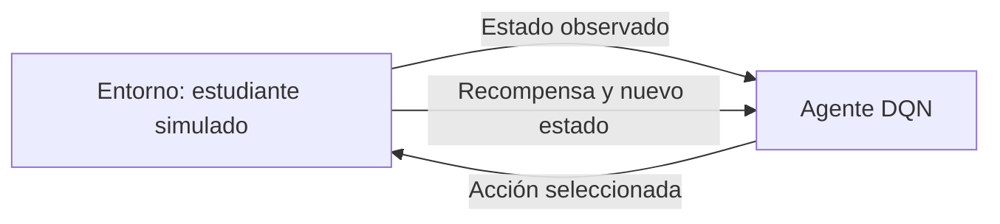
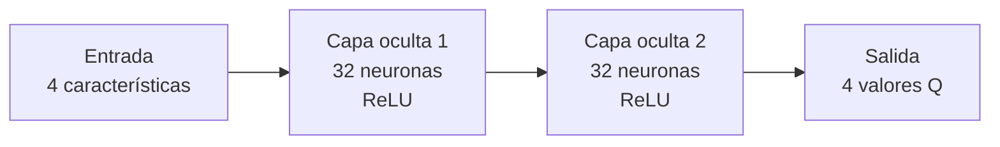
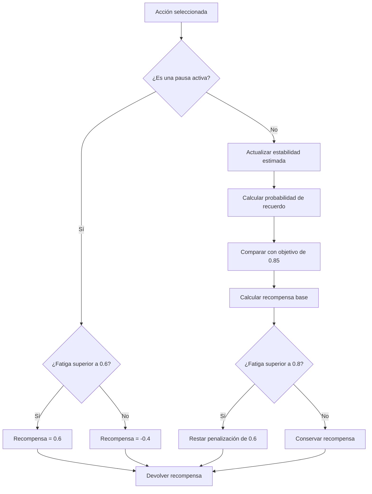
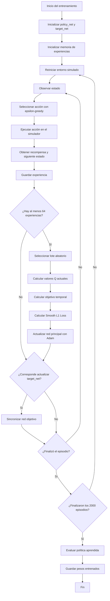
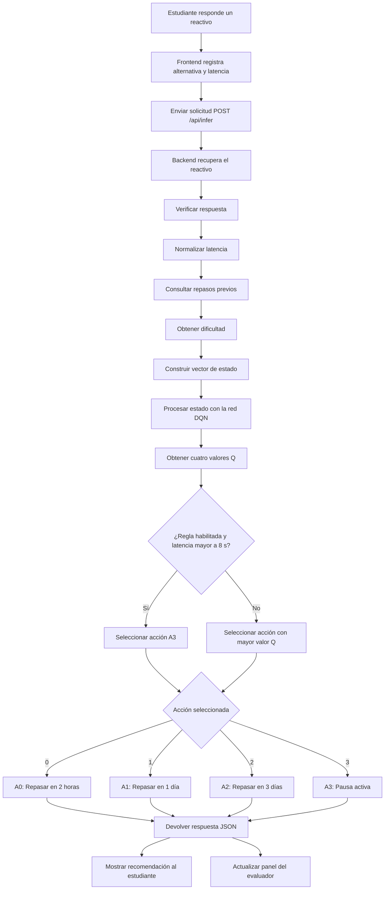
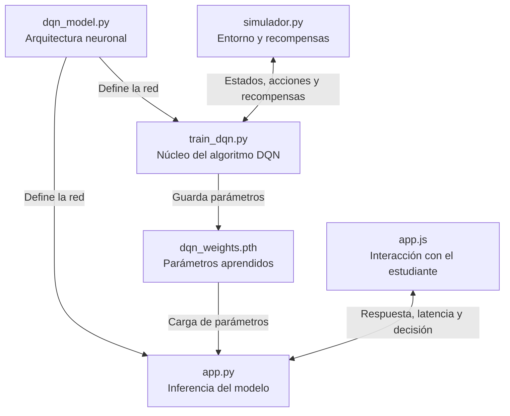
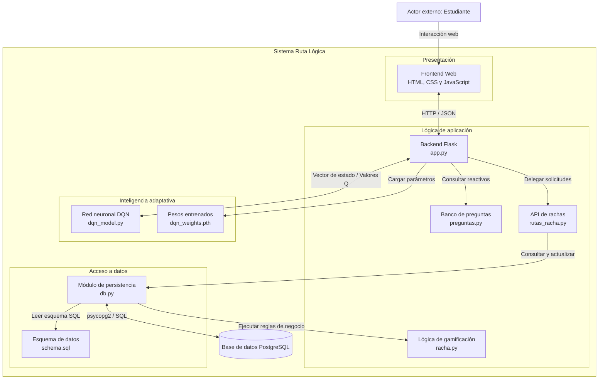
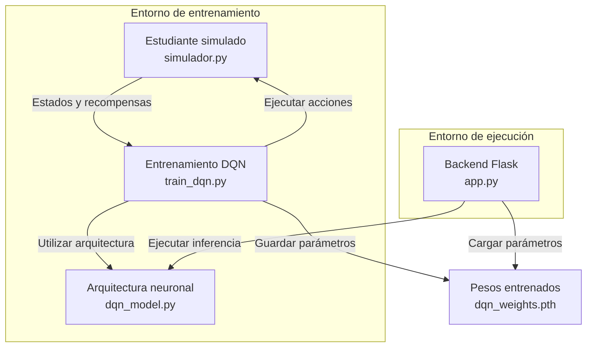

# Ruta Lógica - Demo Proyecto de Tesis

## 1. Descripción del proyecto

Ruta Lógica es un prototipo de sistema web de repetición espaciada basado en el algoritmo Deep Q-Networks (DQN) con PyTorch, orientado a la estimulación del interés cognitivo en el razonamiento lógico-matemático de estudiantes de 5.° de secundaria de la I.E. 80818 Jorge Basadre Grohmann, Trujillo - 2027.

El sistema analiza las respuestas, los tiempos de reacción, la cantidad de repasos previos y la dificultad de los reactivos para generar recomendaciones adaptativas de repaso y pausas activas.

## 2. Arquitectura del sistema

El prototipo se fundamenta en una arquitectura cliente-servidor que integra componentes de presentación, lógica de aplicación, inteligencia adaptativa, contenido académico, gamificación y persistencia de datos.

La separación de estos componentes permite organizar las responsabilidades del sistema y facilita su mantenimiento, integración y ampliación progresiva.

### 2.1. Tecnologías utilizadas

| Tecnología | Aplicación en el proyecto |
|---|---|
| HTML5 | Estructura de las interfaces web. |
| CSS3 | Diseño visual y adaptación de interfaces. |
| JavaScript | Interactividad, captura de latencia y comunicación con la API. |
| Python 3.11 | Desarrollo de la lógica del backend. |
| Flask | Implementación de servicios REST. |
| PyTorch | Implementación, entrenamiento e inferencia del algoritmo DQN. |
| PostgreSQL | Persistencia del estado de las rachas. |
| psycopg2 | Comunicación entre Python y PostgreSQL. |
| Mermaid | Documentación y diagramación de los componentes. |

## 3. Componentes del sistema

A continuación, se describen los componentes que conforman el prototipo, sus responsabilidades, archivos asociados y relaciones con los demás elementos del sistema.

### 3.1. Usuario del sistema

**Componente:** Estudiante.

**Clasificación:** Actor externo.

El estudiante es el usuario principal del sistema, quien interactúa con la plataforma web mediante un navegador.

**Responsabilidades:**

- Acceder al sistema mediante un código de estudiante.
- Resolver la evaluación general inicial.
- Desarrollar los cuestionarios temáticos.
- Consultar las recomendaciones adaptativas de repaso.
- Participar en las misiones diarias.
- Interactuar con la mascota virtual.
- Realizar las pausas activas recomendadas.

**Interacción:** Se comunica directamente con el frontend mediante la interfaz gráfica del sistema.

### 3.2. Componente de presentación

**Componente:** Frontend Web.

**Clasificación:** Interno.

**Tecnologías:** HTML5, CSS3 y JavaScript.

**Archivos asociados:**

- `frontend/index.html`
- `frontend/styles.css`
- `frontend/app.js`

Este componente proporciona la interfaz gráfica mediante la cual el estudiante interactúa con las funcionalidades del prototipo.

**Responsabilidades:**

- Presentar la pantalla de acceso.
- Mostrar la evaluación general de 16 reactivos.
- Presentar los cuestionarios temáticos.
- Capturar las alternativas seleccionadas.
- Medir la latencia de respuesta en milisegundos.
- Mostrar las recomendaciones de repetición espaciada.
- Gestionar la visualización de las pausas activas.
- Presentar el dashboard de seguimiento.
- Visualizar las rachas y misiones diarias.
- Gestionar la interacción con la mascota virtual Profesor Basadrito.
- Mostrar el vector de estado y los valores Q en el panel del evaluador.

**Interacción:** Se comunica con el backend Flask mediante solicitudes HTTP y respuestas en formato JSON.

### 3.3. Componente de lógica de aplicación

**Componente:** Backend Flask.

**Clasificación:** Interno.

**Tecnologías:** Python y Flask.

**Archivos asociados:**

- `backend/app.py`
- `backend/rutas_racha.py`

Este componente centraliza la lógica de aplicación y coordina la comunicación entre la interfaz web, el banco de preguntas, el modelo de inteligencia artificial y el subsistema de persistencia.

**Responsabilidades:**

- Exponer los endpoints de la API REST.
- Recibir las solicitudes del frontend.
- Recuperar los reactivos de razonamiento lógico-matemático.
- Verificar las respuestas del estudiante.
- Normalizar las variables de entrada.
- Construir el vector de estado del algoritmo DQN.
- Ejecutar la inferencia del modelo.
- Aplicar la regla complementaria de latencia elevada.
- Gestionar las solicitudes relacionadas con las rachas y misiones.
- Devolver los resultados al frontend en formato JSON.

**Interacción:** Se comunica con el frontend, el banco de preguntas, el modelo DQN y el módulo de acceso a datos.

### 3.4. Componente de inteligencia adaptativa

**Componente:** Motor de inferencia Deep Q-Networks (DQN).

**Clasificación:** Interno.

**Tecnología:** PyTorch.

**Archivos asociados:**

- `backend/dqn_model.py`
- `backend/dqn_weights.pth`

Este componente implementa una red neuronal profunda basada en aprendizaje por refuerzo, encargada de estimar el valor de las acciones adaptativas disponibles a partir del estado observado del estudiante.

La red neuronal está compuesta por cuatro entradas, dos capas ocultas de 32 neuronas y cuatro salidas correspondientes a los valores Q de las acciones.

#### 3.4.1. Arquitectura de la red neuronal

| Capa | Número de neuronas | Función |
|---|---:|---|
| Entrada | 4 | Recepción del vector de estado. |
| Oculta 1 | 32 | Procesamiento de características mediante ReLU. |
| Oculta 2 | 32 | Procesamiento de representaciones internas mediante ReLU. |
| Salida | 4 | Estimación de los valores Q. |

#### 3.4.2. Vector de estado

El backend construye un vector de estado compuesto por cuatro variables:

| Variable | Descripción |
|---|---|
| Latencia normalizada | Tiempo empleado por el estudiante para responder. |
| Acierto | Indica si la respuesta seleccionada es correcta o incorrecta. |
| Repasos previos | Número de respuestas anteriores al mismo reactivo contabilizadas en memoria. |
| Dificultad | Nivel de dificultad del reactivo presentado. |

#### 3.4.3. Espacio de acciones

| Identificador | Acción adaptativa |
|---|---|
| A0 | Recomendar repaso en 2 horas. |
| A1 | Recomendar repaso en 1 día. |
| A2 | Recomendar repaso en 3 días. |
| A3 | Recomendar una pausa activa de 2 minutos. |

**Responsabilidades:**

- Definir la arquitectura de la red neuronal profunda.
- Procesar el vector de estado proporcionado por el backend.
- Calcular los valores Q correspondientes a las acciones disponibles.
- Proporcionar información para la selección de la acción adaptativa.
- Utilizar los parámetros obtenidos durante el entrenamiento.

**Interacción:** Recibe el vector de estado desde el backend Flask y devuelve los valores Q. El backend selecciona la acción correspondiente, considerando también la regla complementaria de latencia elevada.

### 3.5. Componente de contenido académico

**Componente:** Banco de preguntas.

**Clasificación:** Interno.

**Archivo asociado:**

- `backend/preguntas.py`

Este componente almacena los reactivos de razonamiento lógico-matemático utilizados durante la evaluación general y las sesiones de práctica temática.

**Temas implementados:**

- Sucesiones y Series Lógicas.
- Planteo de Ecuaciones y Proporciones.
- Problemas de Móviles y Cronometría.
- Porcentajes y Probabilidades.

Cada tema dispone de tres cuestionarios de cinco reactivos, conformando un banco de 60 preguntas.

La evaluación general inicial está compuesta por 16 reactivos reutilizados del banco de preguntas.

**Responsabilidades:**

- Almacenar los enunciados de los reactivos.
- Definir las alternativas de respuesta.
- Identificar la alternativa correcta.
- Establecer los niveles de dificultad.
- Organizar los cuestionarios por tema.
- Proporcionar los reactivos solicitados por el backend.

**Interacción:** El backend Flask consulta este componente para recuperar los cuestionarios y verificar las respuestas del estudiante.

### 3.6. Componente de gamificación

**Componente:** Módulo de rachas y misiones diarias.

**Clasificación:** Interno.

**Archivos asociados:**

- `backend/racha.py`
- `backend/rutas_racha.py`

Este componente incorpora mecanismos de gamificación orientados a incentivar la constancia y la participación del estudiante durante las sesiones de práctica.

El progreso diario está compuesto por cinco misiones, cada una equivalente al 20% de la meta diaria.

#### 3.6.1. Misiones diarias

| Misión | Condición | Progreso |
|---|---|---:|
| M1 | Completar un cuestionario temático de cinco reactivos. | 20% |
| M2 | Completar un cuestionario sin activación de pausas por latencia elevada. | 20% |
| M3 | Obtener al menos un 60% de respuestas correctas. | 20% |
| M4 | Obtener una latencia promedio inferior a seis segundos. | 20% |
| M5 | Completar un segundo cuestionario temático. | 20% |
| **Total** | **Completar las cinco misiones.** | **100%** |

**Responsabilidades:**

- Evaluar el cumplimiento de las misiones diarias.
- Calcular el porcentaje de progreso.
- Gestionar el estado de la racha del estudiante.
- Identificar el cumplimiento de la meta diaria.
- Permitir reclamar el siguiente día de racha.
- Proporcionar al frontend el estado de las misiones para habilitar la personalización de la mascota virtual.

**Interacción:** El módulo de acceso a datos ejecuta las reglas de negocio definidas en `racha.py`, mientras que `rutas_racha.py` permite acceder a estas funcionalidades mediante la API REST.

### 3.7. Componente de acceso a datos

**Componente:** Módulo de persistencia.

**Clasificación:** Interno.

**Tecnologías:** Python, psycopg2 y SQL.

**Archivos asociados:**

- `backend/db.py`
- `backend/schema.sql`

Este componente establece la comunicación entre la lógica de aplicación y el sistema gestor de base de datos PostgreSQL.

**Responsabilidades:**

- Establecer conexiones con PostgreSQL.
- Inicializar las tablas de la base de datos.
- Registrar identificadores de estudiantes.
- Consultar el estado de las rachas.
- Ejecutar las reglas de gamificación sobre el estado recuperado.
- Actualizar el progreso de las misiones diarias.
- Gestionar las transacciones de lectura y escritura.
- Controlar la concurrencia mediante bloqueos de registros.

**Interacción:** Recibe solicitudes desde la API de rachas, utiliza las reglas de negocio del módulo `racha.py` y ejecuta operaciones SQL sobre PostgreSQL.

### 3.8. Componente de almacenamiento

**Componente:** Base de datos PostgreSQL.

**Clasificación:** Externo al backend Flask e integrado en la arquitectura general del sistema.

**Tecnología:** PostgreSQL.

Este componente proporciona el almacenamiento persistente de los identificadores de estudiantes y del estado asociado al sistema de rachas.

**Tablas implementadas:**

| Tabla | Descripción |
|---|---|
| `estudiantes` | Almacena los identificadores y fechas de registro de los estudiantes. |
| `racha_estado` | Almacena la cantidad de días de racha, el cumplimiento de las misiones y la meta diaria. |

**Responsabilidades:**

- Persistir los identificadores de estudiantes.
- Almacenar el estado de las rachas.
- Registrar el cumplimiento de las misiones diarias.
- Mantener el progreso entre sesiones.
- Garantizar la integridad referencial entre las tablas.

**Interacción:** Se comunica con el módulo de acceso a datos mediante el controlador psycopg2 y sentencias SQL.

## 4. Componentes de soporte para el entrenamiento DQN

Estos componentes intervienen durante la etapa de entrenamiento del modelo de inteligencia artificial. No participan directamente en las sesiones de práctica del estudiante.

### 4.1. Entorno de simulación

**Componente:** Estudiante simulado.

**Clasificación:** Interno de soporte.

**Archivo asociado:**

- `backend/simulador.py`

Este componente representa de manera computacional el comportamiento de un estudiante mediante variables simuladas de retención, dificultad, precisión, latencia y fatiga.

**Responsabilidades:**

- Generar estados simulados del estudiante.
- Representar el decaimiento temporal de la memoria.
- Simular respuestas correctas e incorrectas.
- Simular variaciones en la latencia.
- Representar cambios en los niveles de fatiga.
- Calcular recompensas asociadas a las acciones del agente.
- Generar transiciones entre estados.

**Interacción:** Se comunica con el módulo de entrenamiento DQN, recibiendo acciones y devolviendo nuevos estados y recompensas.

### 4.2. Módulo de entrenamiento

**Componente:** Entrenamiento del agente Deep Q-Networks.

**Clasificación:** Interno de soporte.

**Tecnología:** PyTorch.

**Archivo asociado:**

- `backend/train_dqn.py`

Este componente realiza el entrenamiento de la red neuronal profunda mediante interacciones sucesivas con el entorno de simulación.

**Responsabilidades:**

- Inicializar la red neuronal principal y la red objetivo.
- Ejecutar la estrategia de exploración epsilon-greedy.
- Almacenar experiencias en una memoria de repetición.
- Seleccionar lotes de experiencias para el entrenamiento.
- Calcular la función de pérdida Smooth L1.
- Actualizar los parámetros de la red neuronal.
- Evaluar la política aprendida frente a una política aleatoria.
- Exportar los parámetros entrenados al archivo `dqn_weights.pth`.

**Interacción:** Utiliza el entorno de simulación y la arquitectura definida en `dqn_model.py` para entrenar el modelo.

### 4.3. Artefacto del modelo entrenado

**Componente:** Pesos entrenados del modelo DQN.

**Clasificación:** Artefacto interno.

**Archivo asociado:**

- `backend/dqn_weights.pth`

Este archivo almacena los parámetros de la red neuronal obtenidos durante el proceso de entrenamiento.

**Responsabilidades:**

- Conservar los parámetros aprendidos por el modelo.
- Permitir la carga de la red neuronal entrenada.
- Facilitar la ejecución de inferencias sin repetir el entrenamiento en cada inicio del sistema.

**Interacción:** Es generado por `train_dqn.py` y posteriormente cargado por `app.py` durante la inicialización del backend.

## 5. Implementación del algoritmo Deep Q-Networks (DQN)

### 5.1. Propósito del algoritmo en el proyecto

Deep Q-Networks es un algoritmo de aprendizaje por refuerzo profundo que combina Q-learning con redes neuronales artificiales para aproximar los valores asociados a las acciones que un agente puede ejecutar dentro de un entorno.

En Ruta Lógica, el algoritmo DQN tiene como propósito generar recomendaciones adaptativas sobre el momento en que el estudiante debería repasar un reactivo de razonamiento lógico-matemático o realizar una pausa activa.

A diferencia de una programación uniforme de repasos, el prototipo considera las características observables de cada interacción para estimar el valor de las acciones disponibles.

La implementación se divide en dos etapas:

- **Entrenamiento:** el agente aprende una política de decisión mediante interacciones con un estudiante simulado.
- **Inferencia:** el modelo entrenado procesa las respuestas del estudiante durante la utilización de la plataforma web.

La inferencia utiliza los parámetros aprendidos previamente y no modifica los pesos de la red neuronal durante las sesiones de práctica.

### 5.2. Formulación del Proceso de Decisión de Markov (MDP)

El entrenamiento se plantea mediante un modelo de decisión secuencial inspirado en un Proceso de Decisión de Markov (MDP), representado mediante la siguiente tupla:

$$
MDP = (S,A,P,R,\gamma)
$$

Donde:

| Elemento | Descripción | Aplicación en Ruta Lógica |
|---|---|---|
| S | Espacio de estados. | Latencia, acierto, repasos y dificultad. |
| A | Espacio de acciones. | Tres intervalos de repaso y una pausa activa. |
| P | Función de transición. | Cambios de estado generados por el simulador. |
| R | Función de recompensa. | Valoración del espaciamiento y de las pausas. |
| γ | Factor de descuento. | Ponderación de recompensas futuras con un valor de 0.9. |

El agente observa un estado, selecciona una acción, recibe una recompensa y obtiene una nueva observación del entorno.



En el simulador existen variables internas como la estabilidad de la memoria y la fatiga que no son observadas directamente por el agente.

Por tanto, el vector de estado constituye una representación parcial del comportamiento simulado y no garantiza por sí mismo el cumplimiento estricto de la propiedad de Markov.

### 5.3. Representación del vector de estado

El agente utiliza un vector de cuatro características:

$$
s_t = [l_t,c_t,n_t,d_t]
$$

Donde:

- $l_t$: latencia normalizada.
- $c_t$: acierto de la respuesta.
- $n_t$: número de repasos normalizado.
- $d_t$: dificultad normalizada.

La construcción del vector de estado se realiza en `backend/app.py`.

#### 5.3.1. Normalización de la latencia

La latencia corresponde al tiempo transcurrido desde la presentación del reactivo hasta que el estudiante selecciona una alternativa.

El frontend registra este tiempo mediante la función `performance.now()` de JavaScript.

La normalización se realiza considerando un límite de 10 000 milisegundos:

$$
l_t = \min\left(\frac{\max(L_t,0)}{10000},1\right)
$$

Donde $L_t$ representa la latencia original en milisegundos.

| Latencia registrada | Latencia normalizada |
|---:|---:|
| 2 000 ms | 0.2 |
| 4 000 ms | 0.4 |
| 6 000 ms | 0.6 |
| 8 000 ms | 0.8 |
| 10 000 ms | 1.0 |
| 12 000 ms | 1.0 |

La normalización limita la variable al intervalo comprendido entre 0 y 1.

#### 5.3.2. Acierto de la respuesta

El backend compara la alternativa seleccionada con la respuesta correcta registrada en el banco de preguntas.

$$
c_t =
\begin{cases}
1, & \text{respuesta correcta} \\
0, & \text{respuesta incorrecta}
\end{cases}
$$

Esta variable representa el resultado del reactivo actual, no la precisión histórica acumulada del estudiante.

#### 5.3.3. Normalización de los repasos previos

El prototipo contabiliza el número de respuestas anteriores registradas para cada reactivo.

$$
n_t = \frac{\min(N_t,10)}{10}
$$

Donde $N_t$ representa el número de respuestas previas al reactivo.

| Repasos previos | Valor normalizado |
|---:|---:|
| 0 | 0.0 |
| 2 | 0.2 |
| 5 | 0.5 |
| 10 | 1.0 |

Actualmente, este contador se mantiene en memoria mediante el diccionario `review_counts` del backend.

El contador se encuentra asociado al identificador del reactivo, no individualmente al estudiante, y se reinicia al solicitar la evaluación general.

#### 5.3.4. Normalización de la dificultad

Los reactivos se clasifican en tres niveles de dificultad.

$$
d_t = \frac{D_t}{3}
$$

| Nivel | Dificultad original | Dificultad normalizada |
|---|---:|---:|
| Básico | 1 | 0.333 |
| Intermedio | 2 | 0.667 |
| Avanzado | 3 | 1.000 |

La dificultad es una característica previamente definida en el banco de preguntas.

En la versión actual, el algoritmo utiliza esta característica como entrada, pero no modifica automáticamente la dificultad del siguiente reactivo.

#### 5.3.5. Construcción del tensor de entrada

Después de normalizar las características, se construye un tensor de PyTorch:

```python
state_tensor = torch.tensor(
    [
        norm_latency,
        is_correct,
        review_norm,
        difficulty / 3.0
    ],
    dtype=torch.float32
)
```

Este tensor constituye la entrada de la red neuronal DQN durante la inferencia.

### 5.4. Definición del espacio de acciones

El agente dispone de cuatro acciones discretas.

$$
A = \{0,1,2,3\}
$$

| Acción | Decisión | Propósito |
|---|---|---|
| A0 | Repasar en 2 horas. | Recomendar un intervalo de refuerzo inmediato. |
| A1 | Repasar en 1 día. | Recomendar un intervalo de espaciamiento corto. |
| A2 | Repasar en 3 días. | Recomendar un intervalo de espaciamiento extendido. |
| A3 | Pausa activa. | Recomendar una interrupción temporal de la práctica. |

Los intervalos utilizados por el entorno de simulación se expresan en días:

```python
INTERVALOS_DIAS = [2 / 24, 1.0, 3.0]
ACCION_PAUSA = 3
```

La acción de pausa activa se representa en el frontend mediante un temporizador de 120 segundos.

Estas acciones constituyen las alternativas entre las cuales el agente aprende a decidir durante el entrenamiento.

### 5.5. Arquitectura de la red neuronal DQN

La arquitectura neuronal se encuentra implementada en `backend/dqn_model.py` mediante la biblioteca PyTorch.

Se utiliza una red neuronal completamente conectada con la siguiente estructura:



La implementación de la red neuronal es la siguiente:

```python
class DQNNetwork(nn.Module):

    def __init__(self, state_dim=4, action_dim=4):
        super(DQNNetwork, self).__init__()

        self.fc = nn.Sequential(
            nn.Linear(state_dim, 32),
            nn.ReLU(),
            nn.Linear(32, 32),
            nn.ReLU(),
            nn.Linear(32, action_dim)
        )

    def forward(self, state):
        return self.fc(state)
```

#### 5.5.1. Capa de entrada

Recibe las cuatro características que describen la interacción observada del estudiante:

- Latencia normalizada.
- Acierto.
- Repasos previos normalizados.
- Dificultad normalizada.

#### 5.5.2. Capas ocultas

La red utiliza dos capas ocultas de 32 neuronas cada una.

Ambas emplean la función de activación ReLU:

$$
ReLU(x) = \max(0,x)
$$

Estas capas permiten aprender relaciones no lineales entre las características de entrada y los valores asociados a las acciones.

#### 5.5.3. Capa de salida

La última capa contiene cuatro neuronas sin una función de activación adicional.

Cada neurona representa el valor Q estimado de una acción:

$$
Q(s_t) = [Q(s_t,A_0),Q(s_t,A_1),Q(s_t,A_2),Q(s_t,A_3)]
$$

Los valores Q representan estimaciones de recompensa acumulada descontada.

No corresponden a probabilidades ni porcentajes de acierto.

La red contiene un total de 1 348 parámetros entrenables.

| Capa | Parámetros |
|---|---:|
| Entrada a capa oculta 1 | 160 |
| Capa oculta 1 a capa oculta 2 | 1 056 |
| Capa oculta 2 a salida | 132 |
| **Total** | **1 348** |

### 5.6. Entorno de simulación del estudiante

Antes de utilizar el modelo durante las sesiones de práctica, se realiza un entrenamiento mediante un entorno simulado.

El archivo `backend/simulador.py` implementa la clase `EstudianteSimulado`.

Este entorno genera interacciones artificiales considerando:

- Dificultad del reactivo.
- Número de repasos previos.
- Estabilidad de la memoria.
- Tiempo transcurrido desde el último repaso.
- Probabilidad de respuesta correcta.
- Latencia de respuesta.
- Nivel interno de fatiga.

La fatiga y la estabilidad de la memoria son variables internas del simulador que el agente DQN no observa directamente.

#### 5.6.1. Estabilidad de la memoria

El simulador asigna una estabilidad inicial en función de la dificultad.

| Dificultad | Estabilidad base en días |
|---|---:|
| Básico | 3.0 |
| Intermedio | 1.5 |
| Avanzado | 0.8 |

La estabilidad se incrementa conforme aumenta el número de repasos:

$$
M = B_d \cdot 1.4^N
$$

Donde:

- $M$: estabilidad simulada de la memoria.
- $B_d$: estabilidad base según la dificultad.
- $N$: número de repasos previos.

Implementación:

```python
base = {1: 3.0, 2: 1.5, 3: 0.8}[self.dificultad]

self.estabilidad = base * (1.4 ** self.repasos)
```

#### 5.6.2. Decaimiento de la memoria

La probabilidad de recuerdo se representa mediante una función exponencial:

$$
p_{\text{recuerdo}} = e^{-\frac{t}{M}}
$$

Donde:

- $t$: tiempo transcurrido desde el último repaso.
- $M$: estabilidad simulada de la memoria.

Esta función permite representar una disminución progresiva de la probabilidad de recuerdo conforme transcurre el tiempo.

Implementación:

```python
recuerdo = math.exp(
    -self.dias_desde_ultimo / self.estabilidad
)
```

#### 5.6.3. Simulación de respuestas correctas

La probabilidad de acierto considera tanto la probabilidad de recuerdo como la fatiga simulada:

$$
p_{\text{acierto}} =
\operatorname{clip}
\left(
p_{\text{recuerdo}}(1-0.4F)+0.05,
0,1
\right)
$$

Donde $F$ representa el nivel interno de fatiga.

La respuesta se genera de forma probabilística:

```python
p_acierto = min(
    max(recuerdo * (1 - 0.4 * self.fatiga) + 0.05, 0.0),
    1.0
)

self.acierto = (
    1.0 if self.rng.random() < p_acierto else 0.0
)
```

#### 5.6.4. Simulación de la latencia

La latencia simulada depende de la dificultad, la fatiga, el resultado del reactivo y un componente aleatorio.

```python
lat = (
    0.15 + 0.08 * self.dificultad
) * (1 + 1.5 * self.fatiga)

lat += self.rng.gauss(0, 0.04)

if self.acierto == 0:
    lat += 0.1

self.latencia = min(max(lat, 0.02), 1.0)
```

Este mecanismo permite generar diferentes patrones de respuesta durante el entrenamiento.

#### 5.6.5. Evolución del entorno

Cada episodio contiene 25 pasos de interacción.

Después de ejecutar una acción:

1. El entorno calcula la recompensa.
2. Actualiza el nivel de fatiga.
3. Incrementa el contador de pasos.
4. Genera las características de un nuevo reactivo simulado.
5. Devuelve una nueva observación al agente.

El simulador no conserva una trayectoria longitudinal de memoria para cada reactivo entre pasos. La estabilidad y los repasos del siguiente reactivo se generan nuevamente, mientras que la fatiga evoluciona durante el episodio.

Los parámetros del simulador son supuestos de diseño de la demostración y todavía no han sido calibrados mediante datos de estudiantes reales.

### 5.7. Función de recompensa

La función de recompensa constituye el mecanismo mediante el cual el agente recibe retroalimentación sobre las decisiones ejecutadas durante el entrenamiento.

En Ruta Lógica, la recompensa considera dos tipos de acciones:

- Acciones de espaciamiento.
- Acción de pausa activa.

La implementación se encuentra en el método `step()` de `backend/simulador.py`.

#### 5.7.1. Recompensa de las acciones de espaciamiento

Cuando el agente selecciona una acción de repaso, el simulador calcula una nueva estabilidad de memoria en función del acierto:

$$
M' =
\begin{cases}
1.5M, & \text{si la respuesta es correcta} \\
0.6M, & \text{si la respuesta es incorrecta}
\end{cases}
$$

Posteriormente, estima la probabilidad de recuerdo para el intervalo seleccionado:

$$
p_{\text{próximo}} =
e^{-\frac{I_a}{M'}}
$$

Donde $I_a$ corresponde al intervalo de repaso seleccionado.

Se establece una probabilidad de recuerdo objetivo del 85%:

$$
p_{\text{objetivo}}=0.85
$$

La recompensa base se calcula mediante:

$$
r_t = 1-3|p_{\text{próximo}}-0.85|
$$

Cuanto más próxima se encuentre la probabilidad de recuerdo estimada al objetivo, mayor será la recompensa.

Este mecanismo busca evitar tanto los repasos excesivamente próximos como los intervalos demasiado prolongados.

#### 5.7.2. Penalización por fatiga elevada

Cuando el agente selecciona una acción de espaciamiento y la fatiga simulada supera el valor de 0.8, se aplica una penalización adicional de 0.6.

$$
r_t =
1-3|p_{\text{próximo}}-0.85|
-0.6\mathbb{1}_{F>0.8}
$$

Donde:

- $F$: nivel de fatiga simulada.
- $\mathbb{1}_{F>0.8}$: indicador que vale 1 cuando la fatiga supera 0.8 y 0 en caso contrario.

#### 5.7.3. Recompensa de la pausa activa

Cuando el agente selecciona la acción A3, la recompensa depende del nivel interno de fatiga:

$$
r_t =
\begin{cases}
0.6, & F>0.6 \\
-0.4, & F\leq0.6
\end{cases}
$$

La pausa recibe una recompensa positiva cuando existe fatiga elevada dentro del simulador.

Cuando la fatiga es reducida, la pausa recibe una recompensa negativa para evitar interrupciones innecesarias.

La acción de pausa establece inicialmente la fatiga simulada en 0.1, antes del incremento aplicado al finalizar cada paso.

#### 5.7.4. Implementación de la función de recompensa

```python
if accion == ACCION_PAUSA:

    recompensa = (
        0.6 if self.fatiga > 0.6 else -0.4
    )

    self.fatiga = 0.1

else:

    s_nueva = self.estabilidad * (
        1.5 if self.acierto else 0.6
    )

    recuerdo_proximo = math.exp(
        -INTERVALOS_DIAS[accion] / s_nueva
    )

    recompensa = 1.0 - 3.0 * abs(
        recuerdo_proximo - RECUERDO_OBJETIVO
    )

    if self.fatiga > 0.8:
        recompensa -= 0.6
```

#### 5.7.5. Diagrama del cálculo de recompensa



La función de recompensa optimiza indicadores simulados de retención y fatiga. No mide directamente el interés cognitivo del estudiante.

El efecto sobre el interés cognitivo deberá determinarse posteriormente mediante los instrumentos y el diseño cuasiexperimental del proyecto de investigación.

### 5.8. Hiperparámetros de entrenamiento

El entrenamiento se encuentra implementado en `backend/train_dqn.py`.

Los hiperparámetros utilizados son los siguientes:

| Hiperparámetro | Valor | Función |
|---|---:|---|
| Episodios | 2 000 | Número de ciclos de entrenamiento. |
| Pasos por episodio | 25 | Interacciones simuladas por episodio. |
| Gamma | 0.9 | Factor de descuento de recompensas futuras. |
| Learning rate | 0.001 | Tasa de aprendizaje del optimizador. |
| Batch size | 64 | Tamaño del lote de experiencias. |
| Replay buffer | 20 000 | Capacidad máxima de almacenamiento de experiencias. |
| Actualización de red objetivo | 200 pasos | Frecuencia de sincronización de parámetros. |
| Epsilon inicial | 1.0 | Exploración inicial. |
| Epsilon mínimo | 0.05 | Exploración mínima. |
| Optimizador | Adam | Actualización de los parámetros neuronales. |
| Función de pérdida | Smooth L1 | Medición del error de estimación de valores Q. |
| Gradient clipping | 5.0 | Limitación de la norma del gradiente. |
| Semilla de entrenamiento | 0 | Control de la aleatoriedad. |
| Semilla de evaluación | 123 | Generación del entorno de evaluación. |

El entrenamiento contempla 50 000 pasos de interacción simulada:

$$
2000 \times 25 = 50000
$$

### 5.9. Proceso de entrenamiento del agente DQN

El entrenamiento se realiza mediante dos redes neuronales:

- Red principal o `policy_net`.
- Red objetivo o `target_net`.

Ambas utilizan la arquitectura definida en `dqn_model.py`.

#### 5.9.1. Inicialización de las redes

```python
policy_net = DQNNetwork(4, 4)

target_net = DQNNetwork(4, 4)

target_net.load_state_dict(
    policy_net.state_dict()
)

target_net.eval()
```

La red principal actualiza sus parámetros durante el entrenamiento.

La red objetivo proporciona estimaciones de referencia para el cálculo del objetivo temporal y se sincroniza periódicamente con la red principal.

#### 5.9.2. Estrategia epsilon-greedy

El agente utiliza una estrategia epsilon-greedy para equilibrar la exploración y la explotación.

- Exploración: seleccionar una acción aleatoria.
- Explotación: seleccionar la acción con mayor valor Q estimado.

La política se expresa mediante:

$$
a_t =
\begin{cases}
\text{acción aleatoria}, & \text{con probabilidad }\epsilon \\
\arg\max_a Q(s_t,a), & \text{con probabilidad }1-\epsilon
\end{cases}
$$

Implementación:

```python
def elegir_accion(estado, epsilon):

    if random.random() < epsilon:
        return random.randrange(4)

    with torch.no_grad():
        return int(
            policy_net(
                torch.tensor(estado).unsqueeze(0)
            ).argmax().item()
        )
```

El valor de epsilon disminuye progresivamente desde 1.0 hasta 0.05 durante el primer 60% del entrenamiento.

Esto permite que el agente explore las acciones inicialmente y aumente la utilización de la política aprendida conforme avanza el entrenamiento.

#### 5.9.3. Memoria de repetición de experiencias

El agente almacena las interacciones con el entorno en una memoria denominada Experience Replay Buffer.

Cada experiencia contiene:

$$
e_t=(s_t,a_t,r_t,s_{t+1},d_t)
$$

Donde:

- $s_t$: estado observado.
- $a_t$: acción ejecutada.
- $r_t$: recompensa obtenida.
- $s_{t+1}$: siguiente estado observado.
- $d_t$: indicador de finalización del episodio.

Implementación:

```python
memoria = deque(maxlen=CAPACIDAD_MEMORIA)
```

```python
memoria.append(
    (
        estado,
        accion,
        recompensa,
        estado2,
        float(hecho)
    )
)
```

Durante el entrenamiento se seleccionan aleatoriamente lotes de 64 experiencias.

Este mecanismo reduce la dependencia temporal entre las experiencias utilizadas para actualizar la red.

#### 5.9.4. Cálculo del valor Q actual

La red principal calcula los valores Q correspondientes al estado almacenado.

Posteriormente, se recupera el valor asociado a la acción ejecutada:

```python
q_actual = policy_net(s).gather(
    1, a
).squeeze(1)
```

Matemáticamente:

$$
Q_{\text{actual}}=Q_{\theta}(s_t,a_t)
$$

Donde $\theta$ representa los parámetros de la red principal.

#### 5.9.5. Cálculo del objetivo temporal

El objetivo de aprendizaje se calcula mediante una formulación basada en la ecuación de Bellman:

$$
y_t =
r_t+
\gamma(1-d_t)
\max_{a'}Q_{\theta^-}(s_{t+1},a')
$$

Donde:

- $y_t$: objetivo temporal.
- $r_t$: recompensa inmediata.
- $\gamma$: factor de descuento.
- $d_t$: indicador de finalización.
- $\theta^-$: parámetros de la red objetivo.
- $a'$: acciones disponibles en el siguiente estado.

Implementación:

```python
with torch.no_grad():

    q_siguiente = target_net(s2).max(1).values

    objetivo = r + GAMMA * q_siguiente * (1 - d)
```

Cuando el episodio finaliza, el término correspondiente a la recompensa futura se anula.

#### 5.9.6. Función de pérdida

Para comparar los valores estimados por la red principal con los objetivos temporales se utiliza la función Smooth L1 Loss.

Esta función combina un comportamiento cuadrático para errores pequeños y un comportamiento lineal para errores grandes.

Sea:

$$
\delta = Q_{\text{actual}}-y_t
$$

La función de pérdida individual es:

$$
L(\delta)=
\begin{cases}
0.5\delta^2, & |\delta|<1 \\
|\delta|-0.5, & |\delta|\geq1
\end{cases}
$$

Implementación:

```python
perdida = nn.functional.smooth_l1_loss(
    q_actual,
    objetivo
)
```

Su finalidad es reducir el error entre las estimaciones de la red principal y los objetivos calculados.

#### 5.9.7. Actualización de parámetros

La actualización de la red neuronal se realiza mediante el optimizador Adam.

```python
optimizador = torch.optim.Adam(
    policy_net.parameters(),
    lr=LR
)
```

Durante cada actualización se ejecutan las siguientes operaciones:

```python
optimizador.zero_grad()

perdida.backward()

nn.utils.clip_grad_norm_(
    policy_net.parameters(),
    5.0
)

optimizador.step()
```

Estas operaciones permiten calcular los gradientes, limitar su norma y actualizar los parámetros de la red principal.

#### 5.9.8. Actualización de la red objetivo

La red objetivo se sincroniza con la red principal cada 200 pasos.

```python
if pasos_totales % ACTUALIZAR_TARGET_CADA == 0:

    target_net.load_state_dict(
        policy_net.state_dict()
    )
```

Esta separación contribuye a estabilizar los objetivos de aprendizaje durante el entrenamiento.

#### 5.9.9. Diagrama de flujo del entrenamiento DQN



### 5.10. Evaluación de la política aprendida

El archivo `train_dqn.py` incorpora una evaluación comparativa entre dos políticas:

| Política | Descripción |
|---|---|
| Política aleatoria | Selecciona las acciones disponibles de manera aleatoria. |
| Política DQN | Selecciona la acción con mayor valor Q estimado. |

Cada política se evalúa durante 200 episodios de simulación.

La métrica utilizada es la recompensa acumulada promedio por episodio:

$$
\bar{R}=
\frac{1}{E}
\sum_{i=1}^{E}
\sum_{t=1}^{T}r_{i,t}
$$

Donde:

- $E$: número de episodios de evaluación.
- $T$: cantidad de pasos por episodio.
- $r_{i,t}$: recompensa obtenida en cada interacción.

Implementación:

```python
aleatoria = evaluar(
    lambda s: random.randrange(4)
)

aprendida = evaluar(
    lambda s: elegir_accion(s, 0.0)
)

print(f"Política aleatoria: {aleatoria:.2f}")

print(f"Política DQN entrenada: {aprendida:.2f}")
```

Durante el entrenamiento también se realiza una evaluación de la política aprendida cada 250 episodios.

La comparación permite analizar si el agente ha aprendido una política que obtiene mayores recompensas dentro del entorno simulado.

Esta evaluación no constituye una validación pedagógica ni demuestra por sí sola una mejora en el interés cognitivo de estudiantes reales.

### 5.11. Almacenamiento y carga del modelo entrenado

Una vez finalizado el entrenamiento, los parámetros aprendidos se almacenan mediante la función `torch.save()`.

```python
torch.save(
    policy_net.state_dict(),
    "dqn_weights.pth"
)
```

El archivo generado es:

```text
backend/dqn_weights.pth
```

Este archivo permite reutilizar el modelo sin ejecutar nuevamente el entrenamiento cada vez que se inicia el sistema.

Durante la inicialización del backend Flask se reconstruye la arquitectura neuronal y se cargan los pesos:

```python
policy_net = DQNNetwork(
    state_dim=4,
    action_dim=4
)

if os.path.exists(PESOS):

    policy_net.load_state_dict(
        torch.load(
            PESOS,
            map_location="cpu"
        )
    )

policy_net.eval()
```

El modo `eval()` configura la red para su utilización durante la inferencia.

El backend utiliza los pesos previamente entrenados siempre que el archivo se encuentre disponible.

Si el archivo no existe, la implementación actual muestra una advertencia y utiliza parámetros inicializados aleatoriamente. En ese caso, no se debe considerar que las recomendaciones provienen de una política entrenada.

### 5.12. Proceso de inferencia en tiempo real

Una vez iniciado el sistema, el estudiante interactúa con la interfaz web y responde los reactivos de razonamiento lógico-matemático.

El proceso de inferencia se ejecuta mediante el endpoint:

```text
POST /api/infer
```

#### 5.12.1. Captura de la interacción

El frontend registra el instante en que se presenta el reactivo:

```javascript
renderTime = performance.now();
```

Cuando el estudiante selecciona una alternativa, se calcula la latencia:

```javascript
const latencyMs = Math.round(
    performance.now() - renderTime
);
```

Posteriormente, el frontend envía al backend:

- Identificador del reactivo.
- Alternativa seleccionada.
- Latencia en milisegundos.

Ejemplo de solicitud:

```json
{
    "question_id": 1,
    "selected_option": 2,
    "latency_ms": 4500
}
```

#### 5.12.2. Procesamiento en el backend

El backend realiza las siguientes operaciones:

1. Recupera el reactivo correspondiente.
2. Verifica si la alternativa seleccionada es correcta.
3. Normaliza la latencia.
4. Recupera el contador de repasos previos.
5. Obtiene la dificultad del reactivo.
6. Construye el vector de estado.
7. Ejecuta la inferencia neuronal.
8. Selecciona la acción adaptativa.
9. Devuelve los resultados al frontend.

#### 5.12.3. Obtención de valores Q

El tensor de estado se proporciona a la red neuronal:

```python
with torch.no_grad():

    q_values = policy_net(
        state_tensor.unsqueeze(0)
    )
```

La instrucción `torch.no_grad()` desactiva el cálculo de gradientes durante la inferencia.

La red devuelve cuatro valores Q, uno para cada acción.

#### 5.12.4. Selección de la acción

En condiciones normales, se selecciona la acción con mayor valor Q:

$$
a^*=\arg\max_{a\in A}Q(s_t,a)
$$

Implementación:

```python
action_id = int(
    torch.argmax(q_values).item()
)
```

Esta selección representa la decisión de la política aprendida, salvo cuando se activa la regla complementaria de latencia elevada.

### 5.13. Regla complementaria de fatiga atencional

El prototipo incorpora una regla determinista adicional a la política DQN.

Esta regla se encuentra configurada en `backend/app.py`:

```python
USAR_REGLA_FATIGA = True

UMBRAL_FATIGA = 0.8
```

Cuando la latencia normalizada supera el umbral de 0.8, se selecciona directamente la acción A3, correspondiente a la pausa activa.

La lógica implementada es:

```python
with torch.no_grad():

    q_values = policy_net(
        state_tensor.unsqueeze(0)
    )

    if USAR_REGLA_FATIGA and norm_latency > UMBRAL_FATIGA:

        action_id = 3

    else:

        action_id = int(
            torch.argmax(q_values).item()
        )
```

Matemáticamente:

$$
a_t=
\begin{cases}
3, & l_t>0.8 \text{ y regla habilitada} \\
\arg\max_a Q(s_t,a), & \text{en otro caso}
\end{cases}
$$

Debido a que la latencia se normaliza respecto de 10 segundos, el umbral corresponde a tiempos superiores a ocho segundos.

Esta implementación constituye una estrategia híbrida:

- Decisión adaptativa mediante DQN.
- Regla complementaria basada en latencia.

La pausa puede ser seleccionada por el propio modelo DQN o por la regla complementaria.

Es importante distinguir que una latencia elevada no constituye una medición directa de fatiga cognitiva. También puede estar asociada a la dificultad del problema, la reflexión, la distracción u otros factores.

El umbral utilizado es una decisión preliminar del prototipo que deberá evaluarse y ajustarse antes de la intervención experimental.

### 5.14. Ejemplo práctico de funcionamiento

Se considera un ejemplo ilustrativo de la interacción del estudiante con un reactivo.

**Datos de entrada:**

| Característica | Valor |
|---|---:|
| Latencia | 4 500 ms |
| Respuesta | Correcta |
| Repasos previos | 2 |
| Dificultad | 2 |

#### Paso 1. Normalización

$$
l_t=\frac{4500}{10000}=0.45
$$

$$
c_t=1
$$

$$
n_t=\frac{2}{10}=0.2
$$

$$
d_t=\frac{2}{3}\approx0.667
$$

#### Paso 2. Construcción del vector de estado

$$
s_t=[0.45,1.0,0.2,0.667]
$$

#### Paso 3. Inferencia de la red neuronal

Para ilustrar la selección de acciones, se consideran los siguientes valores Q hipotéticos:

| Acción | Valor Q ilustrativo |
|---|---:|
| A0 - Repasar en 2 horas | 3.20 |
| A1 - Repasar en 1 día | 4.10 |
| A2 - Repasar en 3 días | 3.60 |
| A3 - Pausa activa | 2.80 |

#### Paso 4. Selección de la acción

El mayor valor Q corresponde a la acción A1:

$$
a^*=\arg\max[3.20,4.10,3.60,2.80]=1
$$

Como la latencia normalizada de 0.45 no supera el umbral de 0.8, no se activa la regla complementaria.

**Decisión final:** recomendar el repaso en un día.

#### Paso 5. Presentación de resultados

El frontend recibe la acción seleccionada y presenta la recomendación correspondiente al estudiante.

El panel del evaluador muestra:

- Latencia registrada.
- Resultado de la respuesta.
- Vector de estado.
- Valores Q.
- Acción seleccionada.

#### Segundo caso: activación de pausa

Si el estudiante registra una latencia de 9 000 milisegundos:

$$
l_t=\frac{9000}{10000}=0.9
$$

Como:

$$
0.9>0.8
$$

La regla complementaria selecciona la acción A3, independientemente de cuál sea el mayor valor Q.

**Decisión final:** recomendar una pausa activa de dos minutos.

Los valores Q del primer ejemplo son únicamente ilustrativos y no corresponden a una ejecución real del archivo de pesos.

### 5.15. Diagrama de flujo de inferencia del algoritmo DQN

El siguiente diagrama representa el procedimiento ejecutado desde que el estudiante responde un reactivo hasta que recibe una recomendación adaptativa.



### 5.16. Diferencia entre entrenamiento e inferencia

| Característica | Entrenamiento | Inferencia |
|---|---|---|
| Archivo principal | `train_dqn.py` | `app.py` |
| Entorno | Estudiante simulado. | Plataforma web. |
| Estados | Generados por el simulador. | Construidos desde las respuestas del usuario. |
| Exploración | Epsilon-greedy. | No utiliza exploración aleatoria. |
| Recompensas | Calculadas por el simulador. | No se calculan recompensas de entrenamiento. |
| Replay Buffer | Se utiliza. | No se utiliza. |
| Actualización de pesos | Sí. | No. |
| Red objetivo | Se utiliza. | No se utiliza. |
| Regla complementaria de latencia | No se utiliza. | Sí. |
| Resultado | Parámetros entrenados. | Recomendación adaptativa. |

El entrenamiento permite obtener una política inicial de decisión mediante simulación, mientras que la inferencia utiliza dicha política para generar recomendaciones durante las sesiones de práctica.

### 5.17. Ubicación del algoritmo DQN dentro del proyecto

La implementación del algoritmo Deep Q-Networks no se concentra en un único archivo, sino que se distribuye en diferentes módulos del backend, separando la definición de la arquitectura neuronal, la simulación del entorno, el entrenamiento y la inferencia.

#### 5.17.1. Estructura de archivos relacionados con DQN

```text
backend/
├── dqn_model.py
├── simulador.py
├── train_dqn.py
├── dqn_weights.pth
└── app.py

frontend/
└── app.js
```

#### 5.17.2. Distribución de la implementación

| Archivo | Elemento principal | Responsabilidad dentro del algoritmo |
|---|---|---|
| `backend/dqn_model.py` | Clase `DQNNetwork` | Define la arquitectura de la red neuronal y las acciones disponibles. |
| `backend/simulador.py` | Clase `EstudianteSimulado` | Genera estados, transiciones y recompensas para el entrenamiento. |
| `backend/train_dqn.py` | Función `elegir_accion()` | Implementa la estrategia epsilon-greedy. |
| `backend/train_dqn.py` | Función `entrenar_un_lote()` | Implementa la actualización de los parámetros de la red mediante aprendizaje por refuerzo. |
| `backend/train_dqn.py` | Función `evaluar()` | Evalúa la recompensa acumulada de la política aprendida. |
| `backend/dqn_weights.pth` | Parámetros entrenados | Almacena los pesos y sesgos de la red neuronal. |
| `backend/app.py` | Endpoint `/api/infer` | Construye el vector de estado, ejecuta la inferencia y selecciona la acción adaptativa. |
| `frontend/app.js` | Función `handleAnswer()` | Captura la respuesta y la latencia del estudiante. |
| `frontend/app.js` | Función `renderLab()` | Visualiza el vector de estado, los valores Q y la acción seleccionada. |

#### 5.17.3. Ubicación del núcleo de aprendizaje por refuerzo

El núcleo del algoritmo DQN se encuentra en el archivo `train_dqn.py`, específicamente en la función `entrenar_un_lote()`.

Esta función realiza las siguientes operaciones:

1. Selecciona experiencias almacenadas en el Replay Buffer.
2. Calcula los valores Q actuales mediante la red principal.
3. Calcula los valores Q futuros mediante la red objetivo.
4. Construye el objetivo temporal mediante la ecuación de Bellman.
5. Calcula la función de pérdida Smooth L1.
6. Ejecuta la retropropagación del error.
7. Actualiza los parámetros de la red neuronal mediante Adam.

Por otro lado, `dqn_model.py` define la arquitectura neuronal utilizada tanto durante el entrenamiento como durante la inferencia, pero no ejecuta directamente el proceso de aprendizaje.

#### 5.17.4. Relación entre los archivos del algoritmo



Esta organización permite separar el proceso de entrenamiento del algoritmo de su utilización durante las sesiones de práctica del estudiante.

## 6. Diagrama de componentes del sistema

El siguiente diagrama representa los principales componentes que intervienen durante la ejecución del prototipo, así como sus relaciones y mecanismos de comunicación.



## 7. Diagrama de componentes del entrenamiento DQN

El siguiente diagrama representa la interacción entre los componentes responsables del entrenamiento y la posterior utilización del modelo en el prototipo.



## 8. Comunicación entre componentes

| Componente origen | Componente destino | Mecanismo de comunicación |
|---|---|---|
| Estudiante | Frontend Web | Interfaz gráfica del navegador. |
| Frontend Web | Backend Flask | API REST mediante HTTP y JSON. |
| Backend Flask | Banco de preguntas | Importación de módulos Python. |
| Backend Flask | Modelo DQN | Tensores y funciones de PyTorch. |
| Backend Flask | API de rachas | Flask Blueprint. |
| API de rachas | Módulo de persistencia | Invocación de funciones Python. |
| Módulo de persistencia | Lógica de gamificación | Invocación de funciones Python. |
| Módulo de persistencia | PostgreSQL | psycopg2 y sentencias SQL. |
| Módulo de entrenamiento | Entorno de simulación | Estados, acciones y recompensas. |
| Módulo de entrenamiento | Pesos entrenados | Serialización mediante torch.save(). |
| Backend Flask | Pesos entrenados | Deserialización mediante torch.load(). |

## 9. Alcance actual de la demostración

Ruta Lógica constituye un prototipo preliminar del sistema propuesto en el proyecto de investigación.

### 9.1. Funcionalidades implementadas

- Acceso mediante código de estudiante.
- Evaluación general de 16 reactivos.
- Banco de 60 preguntas.
- Cuatro temas de razonamiento lógico-matemático.
- Captura de latencia en milisegundos.
- Verificación automática de respuestas.
- Construcción del vector de estado.
- Entrenamiento DQN mediante simulación.
- Carga de pesos previamente entrenados.
- Inferencia mediante PyTorch.
- Recomendaciones de repetición espaciada.
- Regla complementaria de latencia elevada.
- Pausas activas.
- Visualización de los valores Q.
- Dashboard de seguimiento.
- Sistema de rachas y misiones diarias.
- Mascota virtual Profesor Basadrito.
- Persistencia del estado de las rachas en PostgreSQL.

### 9.2. Limitaciones actuales

- El modelo se entrena mediante un entorno simulado, no mediante registros históricos de estudiantes reales.
- La política aprendida optimiza una función de recompensa basada en indicadores simulados de retención y fatiga.
- El vector de estado no incluye directamente el tiempo transcurrido desde el último repaso.
- El contador de repasos se mantiene en memoria y no está individualizado por estudiante.
- Los intervalos de repaso se presentan como recomendaciones y no como una calendarización persistente por estudiante y reactivo.
- El algoritmo no selecciona automáticamente la dificultad del siguiente reactivo.
- La fatiga cognitiva no se mide directamente.
- El umbral de latencia de ocho segundos todavía requiere calibración.
- Las respuestas y la telemetría del modelo DQN no se almacenan actualmente de manera persistente en PostgreSQL.
- El modelo no realiza aprendizaje en línea durante las sesiones de práctica.
- La validación cuasiexperimental con estudiantes reales todavía se encuentra pendiente.

### 9.3. Proyección hacia el sistema definitivo

La versión definitiva del sistema deberá incorporar los mecanismos necesarios para la calendarización persistente de repasos, el almacenamiento de interacciones individuales, la calibración del modelo adaptativo y la validación de los indicadores conductuales.

Asimismo, se deberá evaluar la pertinencia de las reglas de gamificación, evitando que incentiven respuestas apresuradas o desincentiven descansos necesarios.

La evaluación del efecto sobre el interés cognitivo en el razonamiento lógico-matemático se realizará mediante los instrumentos y el diseño cuasiexperimental establecidos en el proyecto de investigación.
